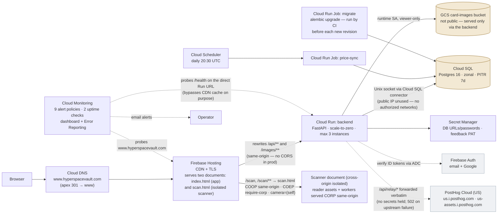
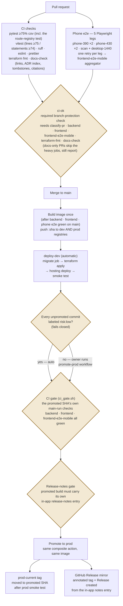

# Cloud footprint and the road to production

*HyperspaceVault · Architecture · View 3 of 3 — Physical*

Everything runs on Google Cloud in `us-central1`, in two mirrored environments defined by one shared Terraform module — a dev project and a prod project — plus a frozen sandbox for infra experiments. Firebase Hosting is the CDN and front door; there is deliberately no load balancer.

*Prepared 2026-07-28 · Updated 2026-10-18 — as of release v2.0.1 (prod `c65cf87`) with the v2.1 candidate on dev (main `d3118c5`) · Companion views: [Conceptual](Architecture_Conceptual.md) (domain & actors) · [Logical](Architecture_Logical.md) (components & data)*

## Production runtime topology

**Prod (swu-prod) — request path and managed services**

The dev project (`swu-dev-jbapps`) is the same module with smaller knobs — one max instance, smaller database tier, no custom domain. A third project (`swu-sandbox`) exists only so infrastructure experiments never touch, or bill like, production.

**Four Hosting rewrites, two documents.** `/api/**` and `/images/**` go to Cloud Run; `/shared/**` serves the app document (so a share link deep-links); `/scan` and `/scan/**` serve the scanner document. The scanner paths carry `Cross-Origin-Opener-Policy: same-origin`, `Cross-Origin-Embedder-Policy: require-corp` and `Permissions-Policy: camera=(self)` so the page is cross-origin isolated and may use the camera and `SharedArrayBuffer`; the vendored reader assets (`/vendor/scan/**`) and worker bundles (`/scan-workers/**`) carry `Cross-Origin-Resource-Policy: same-origin` so that isolated page may load them. The main document's headers are untouched. Analytics never leaves the origin from the browser's point of view: posthog-js posts to `/api/relay/*`, which the backend forwards to PostHog's US ingestion and asset hosts.

| Edge caching | Policy | Why |
|---|---|---|
| Public catalog reads | `max-age=300, s-maxage=3600` | Guests hit the CDN, not the backend; ≤1h staleness accepted |
| Card images | `max-age=31536000, immutable` | Object paths are immutable by convention; cache forever |
| Vendored scanner assets (`/vendor/scan/**`) | `public, max-age=31536000, immutable` | Reader bundle, WASM runtime and OCR models are copied once, never rebuilt; fetched on first camera use only |
| Scanner document (`/scan`, `/scan/**`, `/scan.html`) | `no-cache` | The isolation headers must always come fresh from Hosting |
| Shared-vault viewer (`/api/shared/{token}`) | `private, max-age=30` | A viewer may refresh freely; nothing shared-cacheable, token never in logs |
| `/shared/**` pages | `X-Robots-Tag: noindex, nofollow` | A secret link must not be indexed |
| Tenant-scoped routes | `private, no-store` | Vault data must never land in a shared cache |

## From pull request to production

Delivery is **build-once, promote-many**: one Docker image is built per merge and pushed to both environments' registries; promotion re-deploys the exact bytes that dev validated. CI authenticates to Google Cloud with workload identity federation — no stored service-account keys anywhere. Database migrations run as a discrete job, to completion, *before* the new service revision takes traffic.

**CI/CD — GitHub Actions**

- **Human gate by default:** the pipeline ends at dev. Production is a deliberate `workflow_dispatch` with a SHA that must be an ancestor of main.
- **Three gates before prod moves:** the SHA's own main-push run must be green for the required jobs (`ci_gate.sh` — branch protection only proves the PR's checks; this proves the merged commit's), the build must carry its own in-app release-notes entry, and either every commit since the last promote is `risk:low` or the owner dispatched the workflow by hand.
- **Risk-tiered fast lane:** auto-promotion fires only if *every* commit since the last promote carried a `risk:low` label — a whole-build guard that fails closed on any missing label, missing PR, or unreadable state.
- **`prod-current` is the source of truth** for "what is production running" — a tag moved only after the prod smoke test passes, readable without any cloud credentials.
- **Every promote is release-noted:** the promote workflow refuses to ship a build whose version lacks its in-app release-notes entry, then mirrors that entry to a GitHub Release on the public repo — users and the repo see the same story.
- **The phone suite is part of the merge gate.** Five Playwright legs (two viewports sharded in half, plus the fake-camera scan project with the desktop smoke) run in parallel on every code PR and on every main push; a leg that passes on its single retry is reported as flaky, not failed; the image build waits for all three heavy jobs on main, so a red phone run never deploys.
- **Docs-only pushes to main trigger no `ci.yml` run** — only the ~10 s `docs-check.yml`; every pull request, docs-only or not, still gets `classify-pr` + `docs-check` + `ci-ok` so the required check can report. Change detection stays in the job graph as belt-and-braces.

## Environments at a glance

| | dev — swu-dev-jbapps | prod — swu-prod |
|---|---|---|
| Deploys | Automatic on merge to main | Owner-gated promote (or all-risk:low auto) |
| Front door | `swu-dev-jbapps.web.app` | `www.hyperspacevault.com` (apex 301; legacy domain a permanent 301 since 2026-07-30) |
| Running | v2.1 candidate (main `d3118c5`) | v2.0.1 (`c65cf87`) |
| Cloud Run max instances | 1 | 3 — bounds worst-case cost of flooding the anonymous catalog endpoints |
| Cloud SQL tier | db-f1-micro | db-g1-small (applied and live-verified 2026-08-01) |
| Deletion protection | Off | On |
| Alerting | 8 policies (doubles as a canary for alert config) | 9 policies — adds custom-domain uptime |

Local development mirrors the cloud shape with Docker Compose: Postgres 16, the backend (auto-migrating on start), the Vite dev server, and a Firebase Auth *emulator* — so a laptop needs **zero GCP credentials**, and row-level security is exercised identically in local, CI, and prod because the same migrations create the same restricted role everywhere. The phone e2e suite runs against the same emulator, locally and in CI.

## Cost and operations posture — chosen, not defaulted

- **Scale-to-zero everywhere**, bounded above (3 prod / 1 dev instances), with a $50/month billing budget alerting at 50/90/100%. The budget is deliberately managed outside Terraform so CI's cloud identity never holds billing permissions.
- **Uptime checks probe the direct backend URL, not the CDN** — a cached front door would happily serve hits long after the backend died. A second prod-only probe covers the real domain so DNS/TLS/Hosting failures aren't invisible either.
- **Zonal database, no HA** — accepted at current scale, with backups + 7-day point-in-time recovery. Stated RPO ≤ 1h / RTO ≤ 4h — validated: restore drills were performed in both environments (dev rehearsal 2026-07-30, prod drill 2026-08-01) with roughly 26× RTO headroom.
- **Rate limiting is in-memory per instance** (no WAF) — proportionate to current traffic; the instance cap is the backstop against abuse of the anonymous surface, which now includes the analytics relay (bounded by design: the PostHog project token is publishable, and the relay adds no capability beyond origin).
- **Public-repo CI is free on standard runners**, so the five-leg phone matrix costs wall-clock, not money; the docs-only trigger gate is kept as hygiene rather than as a cost control.

> **Known drift, stated on purpose** (an as-built diagram should say so): Google sign-in is enabled in the console but not yet declared in Terraform — the Identity Platform config in the module declares e-mail sign-in only (re-verified 2026-10-18); a tracked backlog item, not a surprise. (Two earlier drift items resolved since this view was first prepared: the prod database tier upgrade was applied 2026-08-01, and the legacy domain became a permanent 301 on 2026-07-30.)

---

*Prepared 2026-07-28 · Updated 2026-10-18 — as of release v2.0.1 (prod `c65cf87`) with the v2.1 candidate on dev (main `d3118c5`), from the as-built system; companion views: [Conceptual](Architecture_Conceptual.md) · [Logical](Architecture_Logical.md)*
